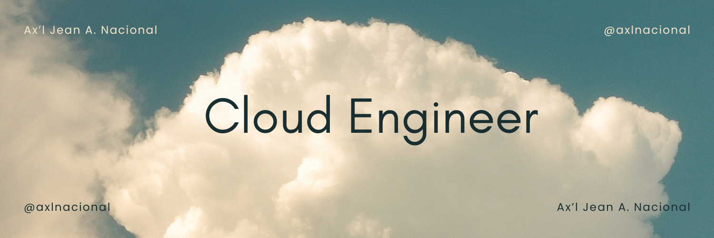

# Hi, I'm Ax'l

  

## About me

- Cloud Engineer with 8+ years of experience designing and supporting scalable infrastructure across enterprise environments.
- Specialize in Linux/Unix and Windows systems, with hands-on expertise in AWS, GCP, and Azure.
- Passionate about automation and cloud optimization — streamlining operations using Shell, Batch, and PowerShell scripting.
- Certified Azure Solutions Architect Expert (AZ-305), with additional certs in DevOps, Networking, and Administration.
- Known for adaptability, problem-solving, and delivering secure, high-performance solutions that drive business success.

## My specialties

`MS Windows Server` | `Linux` | `Cloud` | `GitHub` | `Atlassian` | `Splunk` | `ServiceNow` | `Database` | `HTML` | `Python` | `Bash` | `PowerShell` | `OS Hardening/SRA` | `SAP BO` | `Ansible Tower` | `Terraform` | `CI/CD` | `Cygwin` | `Testing` | `Troubleshooting`

## Certifications

| Certification | Validity |
|---|---|
| AZ-305 – Azure Solutions Architect Expert | Sep 2026 – Sep 2028 |
| AZ-400 – Azure DevOps Engineer Expert | Jun 2025 – Jun 2027 |
| AZ-700 – Azure Network Engineer Associate | Mar 2025 – Mar 2027 |
| AZ-104 – Azure Administrator Associate | Dec 2024 – Dec 2026 |

## How to reach me
- Contact me at [axljeanayalin@gmail.com](mailto:axljeanayalin@gmail.com)
- Checkout my resume here [📝](https://htmlpreview.github.io/?https://raw.githubusercontent.com/axlnacional/axlnacional/main/output/axlnacional-resume.html?sanitize=true), download it from here [⬇️](https://github.com/axlnacional/axlnacional/raw/main/output/axlnacional-resume.pdf)

## Find me around the web
[LinkedIn](https://linkedin.com/in/axljeannacional) | [Instagram](https://instagram.com/axleration01) | [Facebook](https://fb.com/axljeann)